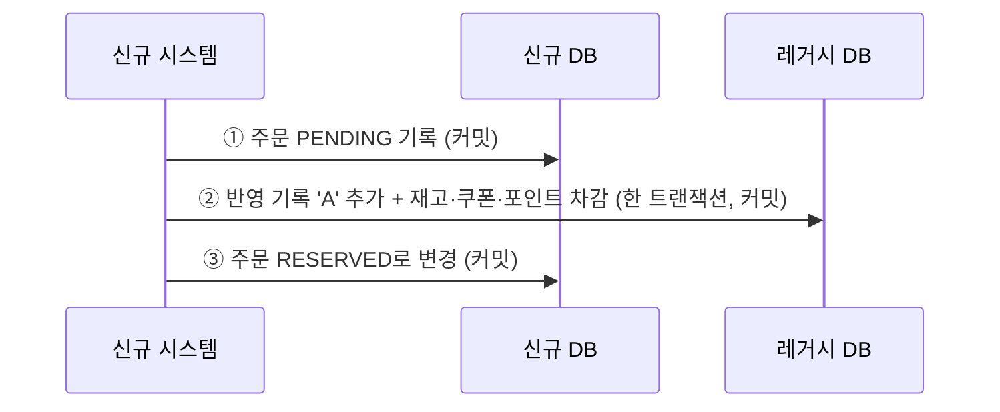

# 장바구니-주문-결제 흐름 재설계

과제 원문은 [assignment/assignment.md](assignment/assignment.md), 레거시 스키마와 데이터를 검토한 근거는 [assignment/analysis.md](assignment/analysis.md)에 있다. 이 문서는 그 분석 위에서 내린 결정과 가정을 적는다. 핵심 결정마다 고려한 대안과 버린 이유는 [adr/](adr/README.md)에 따로 적었다.

## 1. 문제 정의

### 1.1 풀어야 할 문제

10년 된 레거시의 장바구니 → 주문 → 결제 흐름을 서비스 중단 없이 신규 시스템으로 옮긴다. 전환 기간에는 레거시 DB와 신규 시스템이 함께 돌아간다.

이 조건에서 주문 한 건은 **서로 트랜잭션을 공유하지 않는 세 곳**에 걸친 쓰기가 된다.

| 대상 | 내용 | 되돌리는 방법 |
|---|---|---|
| 신규 DB | 주문, 결제 기록 | 로컬 트랜잭션 |
| 레거시 DB | 재고, 내부 포인트, 쿠폰 차감 | 로컬 트랜잭션 |
| 외부 | PG 승인, 제휴 포인트 승인 | 취소 요청이라는 별도 거래 |

세 곳 중 일부만 반영된 채로 남으면 "재고는 빠졌는데 주문이 없다", "돈은 나갔는데 주문이 실패했다" 같은 상태가 된다. 이 설계가 답하려는 질문은 하나다.

> 어느 지점에서 실패하거나 프로세스가 죽어도, 주문 한 건의 결과가 세 곳에서 결국 같은 결론으로 수렴하게 하려면 어떻게 해야 하는가.

### 1.2 레거시가 이미 보여 주는 증상

레거시 데이터에는 위 문제가 실제로 일어난 흔적이 있다(상세는 analysis.md 2.2).

- `ORD20260301004`는 주문이 결제완료인데 결제 행은 미결제이고 승인번호가 없다.
- `ORD20260228009`는 취소됐는데 쿠폰 `CPN002`가 사용 상태로 남아 있다.
- `ORD20260301005`의 부분 취소는 포인트로 낸 몫까지 PG로 환불했거나 포인트 환원을 누락했다.
- 재고와 포인트는 현재 값만 있고 이력이 없어, 맞는지 검증할 수단이 없다.

원인은 구조에 있다. `TB_PAY`는 결제 수단별 상태를 담을 수 없고, 주문과 결제 상태를 묶는 제약이 없으며, 중간 실패를 복구하는 장치가 없다.

### 1.3 위험 지점과 우선순위

| 위험 | 이 설계에서의 처리 | 구현으로 증명 |
|---|---|---|
| 레거시 DB와 신규 DB 중 한쪽만 반영 | 5장 | **예** |
| 동일 상품 동시 주문으로 재고 초과 판매 | 6.1 | 예 (위 구현에 포함) |
| 중복 요청으로 이중 차감 | 5.3 | 예 (위 구현에 포함) |
| 복합 결제의 일부 수단만 성공 | 7장 | 아니오 (설계만) |
| 주문 확인과 결제 사이의 가격 변동 | 6.2 | 일부 (가격 조건 차감) |

가장 위험하다고 본 것은 첫 번째다. 나머지는 한 DB 안이나 한 흐름 안에서 막을 수 있지만, DB 간 부분 반영은 어느 쪽도 스스로 알아챌 수 없고, 공존 기간 내내 모든 주문에서 일어날 수 있기 때문이다.

### 1.4 범위

포함: 장바구니, 주문 생성, 결제, 결제 실패 시 원복, 미결제 주문 만료.

제외: 결제 완료 후의 취소·부분 환불, 배송, 정산, 상품·가격 관리, 회원 관리. 결제 완료 후 취소는 레거시의 정책(쿠폰 환원 여부, 수단별 환불 배분)이 데이터상 일관되지 않아 근거 없이 정할 수 없다. 다만 결제 실패 시 원복이 같은 장치를 쓰므로, 정책이 정해지면 확장할 수 있는 구조로 둔다.

## 2. 전체 구조

```
                    ┌────────────────────── 신규 시스템 ──────────────────────┐
  클라이언트 ──────▶│  장바구니        주문                 결제               │
                    │     │             │                    │                │
                    │     │             │  ┌─────────────────┴──────┐         │
                    │     │             │  │ 외부 결제 포트          │────────┼──▶ PG, 제휴 포인트
                    │     │             │  └────────────────────────┘         │
                    │     │    ┌────────┴──────────────────┐                  │
                    │     │    │ 레거시 자원 포트            │                  │
                    │     │    │ (재고·가격·포인트·쿠폰)     │                  │
                    │     │    └────────┬──────────────────┘                  │
                    │     │             │            복구 작업자 · 대사        │
                    └─────┼─────────────┼──────────────┼──────────────────────┘
                          ▼             │              │
                    ┌──────────┐        ▼              ▼
                    │ 신규 DB  │   ┌──────────────────────────┐
                    │ 장바구니 │   │ 레거시 DB                 │◀── 레거시 애플리케이션
                    │ 주문     │   │ 회원·포인트, 상품·재고·가격│    (관리자, 기존 주문 경로 등)
                    │ 결제     │   │ 쿠폰, 과거 주문·결제       │
                    └──────────┘   │ + 반영 기록 테이블(추가)   │
                                   └──────────────────────────┘
```

구성 요소의 책임:

- **장바구니**: 회원별 상품과 수량을 신규 DB에 보관한다. 가격은 확정하지 않는다.
- **주문**: 주문 의도를 기록하고, 레거시 자원 확보를 요청하고, 상태를 진행시킨다.
- **결제**: 결제 수단별로 승인을 진행하고, 실패하면 승인된 수단을 취소한다.
- **레거시 자원 포트**: 신규 코드가 레거시 테이블에 닿는 유일한 통로다. 재고·가격·포인트·쿠폰을 "주문 한 건 단위로 확보한다 / 반환한다"는 두 연산으로만 노출한다. 나중에 이 자원들이 신규로 옮겨지면 구현만 바꾼다.
- **외부 결제 포트**: PG와 제휴 포인트의 승인·취소·조회.
- **복구 작업자**: 중간 상태에 머문 주문을 찾아 끝까지 진행하거나 되돌린다.
- **대사**: 신규 주문과 레거시 반영 기록을 주기적으로 대조해 어긋난 건을 찾아낸다.

## 3. 주문 흐름

### 3.1 주문 상태

```
PENDING ──▶ RESERVED ──▶ PAID
   │            │
   ▼            ▼
 FAILED     CANCELING ──▶ CANCELED
```

| 상태 | 의미 | 레거시 자원 |
|---|---|---|
| `PENDING` | 주문 의도를 기록했다. 자원 확보 결과를 아직 모른다 | 미정 (반영 기록으로 판단) |
| `RESERVED` | 재고·포인트·쿠폰을 확보했다. 결제 진행 중 | 차감됨 |
| `PAID` | 모든 결제 수단이 승인됐다 | 차감됨 |
| `FAILED` | 자원 확보에 실패했다 (재고 부족, 가격 변동 등) | 차감 안 됨 |
| `CANCELING` | 결제 실패 또는 만료로 원복하기로 했다 | 반환 결과 미정 |
| `CANCELED` | 외부 승인 취소와 자원 반환이 끝났다 | 반환됨 |

확보 상태는 주문 단위 하나다. 재고·쿠폰·포인트를 레거시 트랜잭션 하나로 차감하므로 일부만 확보된 상태가 남지 않고, 실패한 이유는 `fail_reason`으로 남긴다. 자원별 상세 상태는 자원이 두 DB로 나뉘는 고도화 단계(8.3의 2단계 이후)에서 나눈다.

`PENDING`과 `CANCELING`은 "DB 간 작업이 진행 중"임을 뜻하는 중간 상태다. 이 두 상태에 오래 머문 주문이 복구 대상이다. 모든 상태 전이는 `UPDATE ... WHERE status = '이전 상태'` 형태로 하여, 복구 작업자와 정상 흐름이 겹쳐도 한쪽만 성공한다.

### 3.2 단계

1. **장바구니 조회.** 신규 DB의 장바구니와 레거시의 현재 가격·판매 상태를 합쳐 보여 준다.
2. **주문 요청.** 클라이언트는 상품·수량, 사용할 쿠폰·포인트, 자신이 확인한 총액, 멱등 키를 보낸다. 같은 회원이 같은 멱등 키로 낸 주문이 이미 있으면 다시 실행하지 않는다. 요청 내용(품목·수량·쿠폰·포인트)이 그 주문과 같으면 그 주문의 현재 상태를 돌려주고, 다르면 거절한다(4.3).
3. **주문 의도 기록 (신규 DB).** 레거시에 있고 사용 여부(`USE_YN`)가 `'Y'`인 회원인지 확인한다. 아니면 거절한다. 레거시에서 현재 가격을 읽어 금액을 계산하고, 클라이언트가 확인한 총액과 다르면 거절한다. 같으면 주문을 `PENDING`으로 저장한다. 품목 단가는 이때 스냅샷으로 남는다.
4. **자원 확보 (레거시 DB).** 재고, 쿠폰, 포인트를 한 트랜잭션으로 차감한다. 재고 차감은 3에서 읽은 가격과 같을 때만 성공한다. 하나라도 실패하면 전체 롤백하고 주문은 `FAILED`가 된다.
5. **확보 반영 (신규 DB).** 주문을 `RESERVED`로 바꾼다.
6. **결제.** 제휴 포인트 → PG 순으로 승인한다. 모두 성공하면 `PAID`, 하나라도 실패하면 `CANCELING`으로 바꾸고 승인된 수단 취소와 자원 반환을 진행해 `CANCELED`로 끝낸다.
7. **장바구니 정리.** `PAID`가 된 주문의 품목을 장바구니에서 지운다. 실패해도 금전 피해가 없으므로 주문 흐름과 묶지 않는다.

`RESERVED`에서 결제가 끝나지 않은 채 제한 시간(5분)이 지난 주문은 복구 작업자가 6의 실패 경로와 같은 방식으로 되돌린다.

## 4. 레거시 DB와 신규 DB의 분리

### 4.1 결정

| 데이터 | 원본 위치 | 신규 시스템의 접근 |
|---|---|---|
| 장바구니 | **신규 DB** | 읽기·쓰기 |
| 주문, 주문 품목 | **신규 DB** | 읽기·쓰기 |
| 결제 (수단별) | **신규 DB** | 읽기·쓰기 |
| 재고, 가격, 판매 상태 (`TB_GOODS`) | 레거시 DB | 가격·상태는 읽기, 재고는 조건부 차감·반환 |
| 내부 포인트 (`TB_MEMBER.POINT_AMT`) | 레거시 DB | 조건부 차감·반환 |
| 쿠폰 (`TB_COUPON`) | 레거시 DB | 조건부 사용·반환 |
| 회원 (`TB_MEMBER`) | 레거시 DB | 읽기 (주문 시 회원이 있고 `USE_YN = 'Y'`인지 확인) |
| 과거 주문·결제 (`TB_ORDER`, `TB_PAY` 등) | 레거시 DB | 읽기 전용, 이관하지 않음 |
| 반영 기록 (`TB_NEW_ORD_APPLY`) | 레거시 DB (신규 추가) | 읽기·쓰기 |

원칙은 **데이터마다 원본은 한 곳**이다. 같은 값을 양쪽에 두고 동기화하는 구성은 택하지 않는다.

### 4.2 근거

**주문·결제·장바구니를 신규로 옮기는 이유**

- 과제가 재설계를 요구한 범위와 일치한다.
- 레거시 `TB_ORDER`/`TB_PAY`는 수단별 결제 상태, 중간 상태, 멱등 키를 담을 수 없다. 5장과 7장의 장치는 이 구조 위에서는 만들 수 없다.
- 장바구니는 금전 정합성과 무관해 옮기는 위험이 가장 작다.

**재고·포인트·쿠폰을 레거시에 두는 이유**

- 레거시 애플리케이션(관리자, 아직 전환되지 않은 주문 경로)도 쓰는 공유 자원이다. 원본을 옮기면 레거시의 해당 기능을 모두 함께 전환해야 한다.
- 세 자원이 같은 DB에 있으므로 **주문 한 건의 차감을 레거시 로컬 트랜잭션 하나로 묶을 수 있다.** DB 간 불일치가 생길 수 있는 경계가 "신규의 주문 기록 대 레거시의 자원 차감" 한 곳으로 줄어든다. 이 중 일부만 신규로 옮기면 경계가 둘로 늘어난다.
- 가격은 주문 시점에 읽어 스냅샷으로 남기면 충분하다(6.2). 가격 관리 기능까지 이번에 옮길 이유가 없다.

**과거 주문을 이관하지 않는 이유**

- 레거시 주문·결제 데이터는 상태가 어긋난 행이 있어 그대로 옮기면 신규의 제약을 깨뜨린다. 정제 규칙을 정하려면 문서에 없는 레거시 정책을 추측해야 한다.
- 주문 이력 조회는 양쪽을 읽어 합친다. 레거시 쪽은 읽기 전용이다.

**치르는 비용**

- 모든 주문이 DB 간 쓰기가 된다. 5장의 장치가 반드시 필요하다.
- 레거시 쪽 독자(정산, CS 등)는 신규 주문을 직접 볼 수 없다(8.2).
- 재고·포인트의 구조적 약점(이력 없음, 가격과 재고가 한 행)은 이번 단계에서 그대로 남는다.

### 4.3 신규 DB 스키마 (요지)

```
orders           (order_no PK, member_no, status, fail_reason, item_amount, discount_amount, pay_amount,
                  point_amount, coupon_no, idempotency_key, created_at, updated_at)
                  UNIQUE(member_no, idempotency_key)
order_item       (order_no FK → orders, seq, goods_cd, goods_name, qty, unit_price)   PK(order_no, seq)
cart_item        (member_no, goods_cd, qty, added_at)              UNIQUE(member_no, goods_cd)
payment_line     (id PK, order_no, method, amount, status, external_tx_id,
                  idempotency_key UNIQUE, updated_at)
```

`orders`와 `order_item`은 구현했고 전체 DDL은 `src/main/resources/db/new/new_db.sql`에 있다. `cart_item`과 `payment_line`은 설계만 있고 구현 범위 밖이다. ERD는 [docs/erd/new.md](docs/erd/new.md)와 [docs/erd/legacy.md](docs/erd/legacy.md)에 있다.

레거시와 달라지는 점:

- 결제를 수단별 행(`payment_line`)으로 나누고 행마다 상태를 둔다.
- 금액 관계(`item_amount - discount_amount = pay_amount`, `point_amount <= pay_amount`)와 상태 값을 CHECK로 강제한다.
- 주문과 결제 행에 멱등 키를 두고 UNIQUE로 중복을 막는다. 주문의 멱등 키는 **회원별로** 유일하다(`UNIQUE(member_no, idempotency_key)`). 조회에도 회원 번호를 함께 넣어, 다른 회원이 같은 키를 보내도 남의 주문이 반환되지 않는다.
- 멱등 키는 요청 하나를 가리킨다. 같은 회원이 같은 키로 **다른 내용**(품목·수량·쿠폰·포인트)을 보내면 기존 주문을 돌려주지 않고 거절한다(`ORDER_IDEMPOTENCY_KEY_REUSED`). 그대로 돌려주면 클라이언트는 방금 보낸 내용으로 주문됐다고 오해한다. 비교 대상은 주문과 품목의 스냅샷이라 요청 해시 같은 컬럼을 따로 두지 않는다. 품목의 순서는 보지 않고, 사용자가 확인한 총액은 저장하는 값이 아니라 비교하지 않는다.
- 금액(단가, 합계, 할인, 결제 금액, 포인트)은 코드에서 64비트 정수(`Long`)로 다룬다. 수량은 `Int`다. 수량과 단가를 32비트끼리 곱하면 약 21억을 넘는 금액에서 값이 넘친다. SQLite의 `INTEGER`는 값 크기에 따라 8바이트까지 담으므로 두 DB의 컬럼 정의는 바꾸지 않는다.
- `order_item`은 `orders`를 외래 키로 참조한다. SQLite는 외래 키 검사가 기본으로 꺼져 있어 신규 DB 커넥션에서 켠다(`foreign_keys`). 레거시 DB는 외래 키 선언이 없어 켜지 않는다.
- 주문번호는 레거시와 다른 형식을 쓴다(4.5).
- 주문의 금액과 품목은 생성 후 바뀌지 않는다. 바뀌는 것은 `status`뿐이며 조건부 UPDATE로만 바꾼다.
- 미결제 만료는 별도 만료 시각 컬럼 없이 `updated_at`(RESERVED가 된 시각)으로 판단한다. 제한 시간은 5분이다(`checkout.recovery.unpaid-after`).

### 4.4 레거시 DB에 추가하는 것

```
TB_NEW_ORD_APPLY (ORD_NO PK, APPLY_STAT, APPLY_DT, UPD_DT)
  APPLY_STAT: 'A' 차감 적용됨 / 'R' 반환됨 / 'X' 적용 거부(선점)
```

기존 테이블은 변경하지 않는다. DDL은 과제 원본의 사본(`legacy_db.sql`)과 섞이지 않게 `src/main/resources/db/legacy/legacy_new_ord_apply.sql`에 따로 둔다. 이 테이블은 자원 차감과 **같은 레거시 트랜잭션에서** 기록되어, "이 주문의 차감이 레거시에 반영됐는가"에 대한 유일한 답이 된다.

### 4.5 주문번호

**형식 (20자):** `N` + 한국 날짜 `yyMMdd` + 무작위 13자(숫자와 영문 대문자). 예: `N260301K3F9Q0ZT7M2XA`

| 부분 | 길이 | 내용 |
|---|---|---|
| 접두어 | 1 | `N`. 레거시 주문번호는 `ORD`로 시작하므로 겹치지 않는다 |
| 날짜 | 6 | 주문 시각의 한국 날짜. 레거시와 같은 기준이다(4.6) |
| 무작위 | 13 | 36종 문자, `SecureRandom` |

- 일련번호를 채번하지 않는다. 동시 요청이 같은 번호를 받으려고 경합하지 않고, 채번 테이블이나 잠금이 필요 없다.
- 20자로 정한 이유: 이 번호는 레거시 DB의 `TB_NEW_ORD_APPLY.ORD_NO`와 `TB_COUPON.USE_ORD_NO`에도 기록된다. 레거시 주문번호는 14자이고 실제 컬럼 폭은 알 수 없으므로 길이를 가깝게 맞췄다. 처음 구현은 UUID를 붙인 43자였다.
- 레거시 컬럼 폭이 20자보다 좁다면 이 형식도 들어가지 않는다. 그 경우 날짜를 빼거나 무작위 부분을 줄여야 한다.

**번호가 겹쳤을 때:** 하루에 나올 수 있는 번호는 36^13(약 1.7×10^20)개다. 하루 100만 건을 받아도 그날 한 번이라도 겹칠 확률은 10^-8 수준이지만 0은 아니므로 겹쳤을 때의 동작을 정해 둔다.

1. `orders.order_no`가 PK이므로 겹친 번호의 INSERT는 DB가 거절한다. 주문 기록은 항상 INSERT로만 한다(JPA `persist`). `save`(merge)를 쓰면 번호가 같은 기존 주문을 덮어쓰게 되므로 쓰지 않는다.
2. 거절되면 새 번호를 만들어 다시 기록한다. 첫 시도를 포함해 3번까지 한다.
3. 3번 모두 겹치면 주문을 받지 않고 오류를 낸다. 정상적인 생성기에서는 일어날 수 없는 일이므로 생성기 고장으로 본다.
4. 어느 경우에도 기존 주문은 바뀌지 않는다. 주문 기록(5.2의 ①)이 레거시 차감(②)보다 먼저이므로, 번호가 겹친 요청은 레거시에 닿기 전에 걸러진다. 같은 번호로 레거시의 반영 기록이나 재고가 두 번 쓰이는 일은 없다.

멱등 키가 겹친 경우(같은 회원의 재요청)와는 구분된다. INSERT가 거절되면 먼저 같은 회원·같은 멱등 키의 주문이 있는지 확인하고, 있으면 요청 내용이 같은지 본 뒤 그 주문을 돌려준다(내용이 다르면 거절, 4.3). 없을 때만 번호 충돌로 보고 다시 시도한다.

### 4.6 시각과 시간대

- **신규 DB는 UTC다.** `created_at`, `updated_at`은 epoch millis로 저장한다. 서비스가 다른 시간대로 확장돼도 저장된 값의 뜻이 바뀌지 않는다. 애플리케이션 JVM도 UTC로 고정한다.
- **레거시 DB에 쓰는 값은 한국 시간으로 바꾼다.** 레거시의 일시(`'YYYYMMDDHHMISS'`)는 시간대 표시가 없고, 한국 시간으로 기록돼 있다고 가정한다(9장 가정 12). `TB_NEW_ORD_APPLY`의 `APPLY_DT`, `UPD_DT`와 주문번호의 날짜가 해당한다. 변환은 코드 한 곳(`legacy/LegacyTime`)에서 한다.
- UTC 그대로 쓰면 같은 레거시 DB 안에서 기존 데이터와 9시간 어긋나고, 자정 전후 9시간 동안 주문번호의 날짜가 레거시 주문과 하루 달라진다.

## 5. 공존 기간의 데이터 처리: DB 간 쓰기

### 5.1 원칙

두 DB를 하나의 트랜잭션으로 묶지 않는다. 목표는 동시 반영이 아니라 **어디서 끊겨도 한 방향으로 수렴**하는 것이다. 이를 위한 규칙은 넷이다.

1. 신규 DB에 의도를 먼저 기록한다. 흔적이 있어야 끊긴 주문을 찾을 수 있다.
2. 레거시 쪽 작업은 로컬 트랜잭션 하나로 끝내고, 그 안에 반영 기록을 남긴다.
3. 모든 연산은 주문번호 기준으로 멱등하다. 몇 번 다시 실행해도 결과가 같다.
4. 중간 상태에 머문 주문은 복구 작업자가 반영 기록을 보고 결론을 낸다.

### 5.2 확보 절차



②의 레거시 트랜잭션 내용:

```sql
INSERT INTO TB_NEW_ORD_APPLY (ORD_NO, APPLY_STAT, ...) VALUES (?, 'A', ...);   -- PK 충돌 시 이미 처리된 주문
UPDATE TB_GOODS  SET STOCK_QTY = STOCK_QTY - ?
 WHERE GOODS_CD = ? AND SALE_STAT = '01' AND STOCK_QTY >= ? AND SALE_PRC = ?;  -- 품목마다, 상품코드 순
UPDATE TB_COUPON SET USE_YN = 'Y', USE_ORD_NO = ?
 WHERE CPN_NO = ? AND MBR_NO = ? AND USE_YN = 'N';
UPDATE TB_MEMBER SET POINT_AMT = POINT_AMT - ?
 WHERE MBR_NO = ? AND POINT_AMT >= ?;
-- 영향 행 수가 기대와 다른 문장이 하나라도 있으면 전체 ROLLBACK
```

차감이 조건에 맞지 않아 거절되면 반영 기록까지 롤백하고 ③에서 주문을 `FAILED`로 바꾼다. ②가 거절이 아니라 오류로 끝나면 주문은 `PENDING`에 남고 복구 작업자가 결론을 낸다.

**한계: 거절된 주문에는 반영 기록이 남지 않는다.** 그래서 규칙 3(주문번호 기준 멱등)은 반영 기록이 남은 주문, 곧 차감에 성공했거나(`'A'`) 반환했거나(`'R'`) 복구 작업자가 거부한(`'X'`) 주문에만 성립한다. 거절된 주문의 차감을 같은 주문번호로 다시 실행하면 조건을 다시 평가한다. 지금 코드는 `FAILED`를 끝 상태로 두고 같은 주문의 차감을 다시 호출하지 않아 이 경로가 없다. 레거시 쪽만 보면 거절된 주문과 ② 전에 끊긴 주문이 구분되지 않으며, 구분은 신규 DB의 상태와 `fail_reason`으로 한다. 거절할 때 거부 기록 `'X'`를 남기면 해소된다.

### 5.3 실패 지점별 수렴

| 끊긴 위치 | 신규 주문 | 레거시 반영 기록 | 복구 작업자의 처리 |
|---|---|---|---|
| ① 이전 | 없음 | 없음 | 없음. 클라이언트가 같은 멱등 키로 재시도한다 |
| ①과 ② 사이 | `PENDING` | 없음 | 거부 기록 `'X'`를 먼저 넣은 뒤 주문을 `FAILED`로 |
| ② 도중 (롤백됨) | `PENDING` | 없음 | 위와 같음 |
| ②와 ③ 사이 | `PENDING` | `'A'` | 주문을 `RESERVED`로 진행 |
| ③ 이후 | `RESERVED` | `'A'` | 없음 |

**거부 기록 `'X'` 선점이 필요한 이유.** 복구 작업자가 "반영 기록이 없으니 실패"라고 판단한 직후, 지연되던 원래 요청의 ②가 뒤늦게 도착할 수 있다. 그러면 실패 처리된 주문의 재고가 빠진다. 복구 작업자가 먼저 `'X'`를 넣어 두면 뒤늦은 ②는 PK 충돌로 아무것도 하지 못한다. 반대로 ②가 먼저 커밋됐다면 복구 작업자의 `'X'` 기록이 PK 충돌로 실패하고, 반영 기록 `'A'`를 읽어 `RESERVED`로 진행한다. 어느 순서로 겹쳐도 결론은 하나다.

**주문 한 건의 실패가 나머지 복구를 막지 않는다.** 복구 작업자는 중간 상태의 주문을 오래된 순으로 한 건씩 처리하고, 미결제 만료도 같은 방식이다. 한 건이 예외로 끝나면(DB 장애, 예상하지 못한 데이터 등) 로그를 남기고 다음 주문으로 넘어간다. 실패한 주문은 중간 상태 그대로 남으므로 다음 실행에서 다시 대상이 되고, 연산이 멱등하므로 다시 실행해도 안전하다. 한 건에서 멈추면 가장 오래된 주문 하나가 매 실행마다 뒤의 주문 전부를 막게 된다. 같은 주문이 계속 실패하는 경우를 따로 세거나 알리는 장치는 없다(11장).

### 5.4 반환 절차

결제 실패나 만료로 자원을 되돌릴 때도 같은 형태를 쓴다.

1. 신규 DB: 주문을 `CANCELING`으로 (커밋)
2. 레거시 DB: `UPDATE TB_NEW_ORD_APPLY SET APPLY_STAT = 'R' WHERE ORD_NO = ? AND APPLY_STAT = 'A'`의 영향 행 수가 1일 때만 재고·쿠폰·포인트를 되돌린다 (한 트랜잭션, 커밋)
3. 신규 DB: 주문을 `CANCELED`로 (커밋)

반영 기록 전이가 `'A' → 'R'` 한 번만 성공하므로, 반환이 몇 번 재시도돼도 재고가 두 번 늘지 않는다. 무엇을 얼마나 되돌릴지는 신규 DB의 주문 스냅샷에서 읽는다.

### 5.5 대사

복구 작업자가 놓치는 경우에 대비한 마지막 안전망이다. 주기적으로 다음을 대조한다.

- 반영 기록이 `'A'`인데 신규 주문이 `FAILED` 또는 `CANCELED`인 건
- 신규 주문이 `RESERVED` 또는 `PAID`인데 반영 기록이 `'A'`가 아닌 건
- 반영 기록은 있는데 신규 주문이 없는 건

발견된 건은 자동으로 고치지 않고 알린다. 여기까지 온 불일치는 설계가 예상하지 못한 경로이므로 사람이 원인을 봐야 한다.

## 6. 동시성과 가격

### 6.1 동일 상품 동시 주문

재고 차감은 5.2의 조건부 UPDATE로 한다. 읽고 계산해서 덮어쓰지 않으므로 갱신 유실이 없고, `STOCK_QTY >= ?` 조건 때문에 음수가 될 수 없다. 성공 여부는 영향 행 수로 판정한다.

큐로 주문을 직렬화하는 방식과 행 잠금 방식을 함께 검토했다. 조건부 UPDATE를 택한 이유:

- 레거시 주문 경로는 신규 시스템의 큐나 애플리케이션 잠금을 거치지 않는다. 정확성은 DB 문장 수준에서 보장해야 한다.
- 잠금 보유 시간이 문장 하나로 가장 짧다.
- 추가 인프라가 필요 없다.

낙관적 잠금(버전 컬럼)은 레거시 `TB_GOODS`에 컬럼을 추가해야 해서 검토 대상에 넣지 않았다. 기존 레거시 테이블은 바꾸지 않는다(4.4).

트랜잭션은 시작할 때 쓰기 잠금을 잡는다(`BEGIN IMMEDIATE`, 10.3). SQLite에서 동시 요청이 즉시 실패하지 않고 줄을 서게 하는 설정이며, 초과 판매를 막는 것은 조건부 UPDATE다.

큐는 정확성 수단이 아니라 부하 제어 수단으로 본다. 트래픽이 DB 한계를 넘는 단계가 되면 조건부 UPDATE 앞에 붙인다.

여러 상품을 담은 주문은 상품 코드 순으로 차감하고, 하나라도 실패하면 레거시 트랜잭션 전체를 롤백한다. 쿠폰과 포인트도 같은 조건부 방식으로 중복 사용과 음수를 막는다.

### 6.2 운영 중 가격 변동

이번 단계에서는 가격·판매 일정을 별도 테이블로 나누지 않고 `TB_GOODS.SALE_PRC`를 그대로 원본으로 쓴다.

- 장바구니는 가격을 확정하지 않는다. 조회할 때마다 현재 가격을 읽는다.
- 주문 시점에 서버가 가격을 읽어 금액을 계산하고, 클라이언트가 확인한 총액과 다르면 거절한다.
- 주문 품목에 단가를 스냅샷으로 저장한다. 이후 가격이 바뀌어도 주문은 영향받지 않는다.
- 금액 계산과 재고 차감 사이에 가격이 바뀌는 틈은 차감 조건의 `SALE_PRC = ?`가 막는다. 가격이 달라졌으면 차감이 실패하고 주문은 `FAILED`가 된다.

가격 이력과 적용 기간 관리는 상품·재고를 신규로 옮기는 단계의 과제로 남긴다.

## 7. 복합 결제

구현 범위는 아니며 설계 방향만 정한다.

**결정: 일부 수단이 실패하면 승인된 수단을 모두 취소하고 주문을 실패로 끝낸다.**

- 결제 전체를 하나의 DB 트랜잭션으로 감싸지 않는다. 외부 승인은 DB 롤백으로 되돌릴 수 없고, 롤백하면 승인 기록까지 사라진다. 수단별 행(`payment_line`)에 단계마다 상태를 커밋한다.
- 외부를 호출하기 전에 `REQUESTED`를 먼저 기록한다. 이후 `APPROVED`, `FAILED`, `UNKNOWN`, `CANCEL_REQUESTED`, `CANCELED`로 진행한다.
- 우리가 통제할 수 있는 쿠폰과 내부 포인트를 먼저 처리하고, 통제할 수 없는 외부 결제를 뒤에 둔다. 쿠폰과 내부 포인트는 자원 확보 단계(레거시 로컬 트랜잭션)에서 이미 처리되므로, 내부에서 막힐 주문은 외부를 호출하기 전에 걸러진다.
- 외부 결제끼리는 제휴 포인트 → PG 순이다. "되돌리기 쉬운 것 먼저"를 따른 것으로, PG 승인 뒤에는 취소할 일이 없다. "실패가 잦은 것 먼저"(PG 먼저)를 따르면 PG 실패 시 취소할 외부 거래가 없어진다. 지금 순서는 PG가 실패할 때마다 제휴 포인트 취소가 한 번 생기는 값을 치른다(ADR 0005).
- 타임아웃은 실패가 아니라 `UNKNOWN`이다. 거래를 조회해 확인하거나 멱등한 취소를 보낸다.
- 취소 요청도 실패할 수 있다. `CANCEL_REQUESTED`에 머문 행은 복구 작업자가 재시도하고, 한도를 넘으면 수동 처리 대상으로 넘긴다.
- 외부 취소가 모두 확인된 뒤에 5.4의 자원 반환을 진행한다.

실패한 수단만 다시 시도하게 하는 방식은 택하지 않았다. 사용자 편의는 낫지만 승인된 채 방치되는 건을 정리하는 로직과 상태가 늘어난다.

가상계좌처럼 입금이 나중에 이뤄지는 수단은 주문이 `RESERVED`에서 입금 기한까지 머문다. 기한이 지나면 만료 처리로 되돌린다. 구현된 미결제 제한 시간은 수단 구분 없이 5분이므로, 이런 수단을 붙일 때는 수단별 기한을 따로 둔다.

## 8. 전환

### 8.1 트래픽 전환

- 회원 단위로 신규 경로를 연다. 문제가 생기면 스위치를 내려 이후 주문을 레거시 경로로 되돌린다.
- **주문은 만든 쪽이 끝낸다.** 레거시에서 만들어진 진행 중 주문(예: 입금 대기 중인 `ORD20260301003`)은 레거시가, 신규에서 만든 주문은 스위치를 내린 뒤에도 신규가 마무리한다.

### 8.2 레거시 쪽 독자

정산·CS 등이 `TB_ORDER`/`TB_PAY`를 읽는다면 신규 주문이 보이지 않는다. 방향은 신규 주문이 확정(`PAID`, `CANCELED`)될 때 레거시 형식으로 비동기 기록하는 것이다. 이 기록은 조회용 사본이며 원본은 신규 DB다. 이번 구현 범위에는 넣지 않는다.

### 8.3 단계

| 단계 | 내용 |
|---|---|
| 1 (이 문서) | 장바구니·주문·결제를 신규로. 재고·포인트·쿠폰은 레거시에 두고 포트 뒤에서 접근 |
| 2 | 쿠폰과 내부 포인트를 신규로. 포인트 원장 도입 |
| 3 | 재고와 가격을 신규로. 가격 이력·판매 일정 분리 |
| 4 | 레거시 주문 경로 제거, 반영 기록 테이블과 역방향 기록 폐기 |

2단계 이후에는 자원이 두 DB에 나뉘는 기간이 생긴다. 레거시 자원 포트가 "주문 단위 확보·반환"만 노출하므로 호출하는 쪽은 바뀌지 않지만, 포트 구현은 5장과 같은 반영 기록 방식을 자원별로 적용해야 한다.

## 9. 가정

과제 문서와 레거시 데이터만으로는 확인할 수 없어 직접 정한 것들이다. 가정이 틀렸을 때의 영향을 함께 적는다.

| # | 가정 | 틀렸을 때 |
|---|---|---|
| 1 | 공존 기간에 레거시 주문 경로도 주문을 만들고 같은 재고를 차감한다 | 맞든 틀리든 설계는 유효하다. 가장 불리한 쪽으로 가정했다 |
| 2 | 레거시 DB에 테이블 하나(`TB_NEW_ORD_APPLY`)를 추가할 수 있다 | 5장이 성립하지 않는다. 쿠폰은 `USE_ORD_NO`로 대신할 수 있으나 재고·포인트에는 대신할 기록이 없어, 차감 이력을 신규 DB에만 두고 대사에 더 의존해야 한다 |
| 3 | 레거시는 `TB_GOODS`·`TB_MEMBER`를 필요한 컬럼만 갱신한다 (행 전체를 덮어쓰지 않는다) | 레거시의 가격 변경이나 회원 정보 수정이 신규의 재고·포인트 차감을 덮어쓸 수 있다. 신규 쪽에서 막을 수 없고 대사로만 발견된다 |
| 4 | 레거시의 재고 차감이 음수를 만들지 않는다 | 신규가 정확해도 초과 판매가 난다. 레거시 경로를 빨리 닫는 것이 유일한 대응이다 |
| 5 | 재고는 주문 생성 시점에 차감하고, 미결제 주문은 제한 시간(5분) 후 되돌린다 | 결제 시점 차감이 정책이라면 3.2의 순서가 바뀐다. 5장의 장치는 그대로 쓴다. 5분은 설정값이라 바꿀 수 있다 |
| 6 | 재고가 0이 돼도 신규 시스템은 `SALE_STAT`을 바꾸지 않는다. 판매 가능 여부는 `SALE_STAT = '01'`과 `STOCK_QTY`를 함께 본다 | 레거시 화면이 `SALE_STAT`만 보고 품절을 표시한다면 재고 0인 상품이 판매 중으로 보인다. 주문은 재고 조건에서 막힌다 |
| 7 | 쿠폰은 할인, 내부 포인트와 제휴 포인트는 결제 수단이다 (`ORD_AMT - DC_AMT = PAY_AMT`, `PAY_AMT = PG + 포인트 + 제휴 포인트`) | 레거시 데이터 6건이 모두 이 규칙을 따른다 |
| 8 | 결제 실패·만료로 주문이 취소되면 쿠폰과 포인트를 돌려준다 | 결제 완료 후 취소의 환원 정책은 범위 밖이다 |
| 9 | PG와 제휴사는 멱등 키를 받는 취소 API와 거래 조회 API를 제공한다 | `UNKNOWN` 상태를 자동으로 해소할 수 없어 수동 처리 비중이 커진다 |
| 10 | 레거시 쪽 독자는 신규 주문을 조금 늦게 보아도 된다 | 8.2의 비동기 기록 대신 동기 기록이 필요해지고, DB 간 쓰기 경계가 하나 더 생긴다 |
| 11 | 과거 주문은 이관하지 않는다 | 이관이 필요하면 정제 규칙을 따로 정해야 한다 |
| 12 | 레거시 DB의 일시(`'YYYYMMDDHHMISS'`)는 한국 시간이다 | 레거시에 쓰는 일시와 주문번호의 날짜가 기존 데이터와 어긋난다. 변환 지점이 `LegacyTime` 한 곳이므로 시간대만 바꾸면 된다 |
| 13 | `TB_MEMBER.USE_YN = 'N'`은 탈퇴 또는 휴면 회원이다. 이 회원의 주문은 받지 않는다 | 다른 뜻(예: 마케팅 수신 여부)이라면 정상 회원의 주문을 막게 된다. 조건이 `LegacyMemberMapper` 한 곳이므로 그 조건만 바꾸면 된다 |

## 10. 구현으로 증명하는 것과 SQLite의 한계

### 10.1 구현한 범위

5장을 구현했다. 레거시 DB와 신규 DB는 **별도 SQLite 파일, 별도 DataSource, 별도 트랜잭션 매니저**다(신규는 JPA, 레거시는 MyBatis).

| 설계 | 코드 |
|---|---|
| 5.2 확보 절차 (① → ② → ③) | `order/service/OrderService` |
| 5.4 반환 절차 | `order/service/OrderCancelService` |
| 5.3 복구 작업자, 미결제 만료 | `order/service/OrderRecoveryService` |
| 레거시 자원 포트 (반영 기록 + 조건부 차감, 한 트랜잭션) | `legacy/resource/LegacyResourcePort`, `LegacyResourceAdapter` |
| 회원 확인, 6.2 가격 확정과 금액 검증 | `order/service/OrderQuoteService`, `legacy/resource/LegacyMemberPort` |
| 3.1 조건부 상태 전이 | `domain/repository/OrderRepository.transition` |

구현하지 않은 것: 장바구니, 외부 결제(PG·제휴 포인트)와 `PAID` 전이, 대사(5.5), 레거시로의 역방향 기록(8.2), HTTP API. 결제 실패는 `OrderCancelService.cancel`을 직접 호출하는 것으로 대신한다.

### 10.2 테스트가 증명하는 것

| 증명하는 것 | 테스트 |
|---|---|
| 5.3 표의 각 지점에서 중단한 뒤 복구하면 주문 상태와 레거시 자원이 일치한다 | `OrderCrashRecoveryTest` |
| 복구가 실패로 끝낸 주문의 차감이 뒤늦게 도착해도 재고가 줄지 않는다 (거부 기록 선점) | `OrderCrashRecoveryTest`, `OrderConcurrencyTest` |
| 같은 주문의 확보·반환을 반복해도 재고·포인트·쿠폰이 한 번만 변한다 | `LegacyResourceAdapterTest` |
| 재고 3개에 20건이 동시에 주문하면 3건만 성공하고 재고가 0이 된다 | `OrderConcurrencyTest` |
| 같은 멱등 키·같은 쿠폰·같은 주문 취소가 동시에 들어와도 한 번만 반영된다 | `OrderConcurrencyTest` |
| 같은 멱등 키로 같은 내용을 다시 보내면 기존 주문을 돌려주고, 품목·수량·쿠폰·포인트가 다르면 거절하며 레거시 자원은 바뀌지 않는다 | `OrderPlacementTest` |
| 한 주문의 복구·만료 처리가 예외로 끝나도 나머지 주문은 처리되고, 실패한 주문은 다음 실행에서 처리된다 | `OrderCrashRecoveryTest` |
| 수량 × 단가가 32비트 범위를 넘어도 금액이 정확히 계산되고 저장된다 | `OrderPlacementTest` |
| 재고·쿠폰·포인트 중 하나라도 실패하면 레거시에 아무것도 남지 않는다 | `OrderPlacementTest`, `LegacyResourceAdapterTest` |
| 금액 계산과 차감 사이에 가격이 바뀌면 차감하지 않는다 | `OrderPlacementTest` |
| 레거시에 없는 회원과 사용 여부가 `'N'`인 회원의 주문은 받지 않는다 | `OrderPlacementTest` |
| 품목·쿠폰·포인트가 올바르지 않은 요청은 주문을 기록하기 전에 거절하고 레거시 자원을 바꾸지 않는다 | `OrderRequestValidationTest` |
| 멱등 키는 회원별로 유일하다. 다른 회원의 같은 키는 별개의 주문이다 | `OrderPlacementTest`, `NewSchemaConstraintTest` |
| 주문번호가 겹치면 기존 주문을 덮어쓰지 않고 새 번호로 기록한다 | `OrderPlacementTest` |
| 주문번호는 20자이고 날짜는 한국 시간이다. 레거시에 쓰는 일시도 한국 시간이다 | `OrderNoGeneratorTest`, `LegacyTimeTest` |
| 주문 없는 품목을 넣을 수 없고, 금액 관계가 맞지 않는 주문을 넣을 수 없다 | `NewSchemaConstraintTest` |
| 결제 실패·만료 시 자원이 정확히 한 번 돌아온다 | `OrderCancelTest` |
| 두 DB의 트랜잭션이 독립이다 (한쪽만 롤백된다) | `TransactionManagerSeparationTest` |

프로세스 중단은 두 커밋 사이의 지점(`OrderStepObserver`)에서 예외를 던져 재현한다. 운영 구현은 아무것도 하지 않는다.

### 10.3 SQLite의 제약과 한계

- SQLite는 쓰기를 DB 파일 단위로 직렬화하고 행 잠금이 없다. 테스트가 증명하는 것은 **절차의 정확성**이며, 운영 DB에서의 잠금 경합과 처리량은 증명하지 않는다.
- 트랜잭션은 시작할 때 쓰기 잠금을 잡도록 했다(`BEGIN IMMEDIATE`, 두 DB 모두). SQLite의 기본 방식(`BEGIN DEFERRED`)은 처음 쓰는 문장에서 잠금을 잡는데, 읽은 뒤 쓰려는 트랜잭션 둘이 만나면 대기 시간 설정과 무관하게 즉시 실패한다. 이 설정 때문에 한 DB 파일의 쓰기 트랜잭션은 한 번에 하나씩 실행되고, 나머지는 시작 지점에서 `busy_timeout`(5초)만큼 기다린다. 읽기는 막지 않는다.
- `ATTACH`를 쓰면 두 파일을 한 트랜잭션으로 묶을 수 있다. 실제 레거시 DB와 신규 DB는 서로 다른 서버일 것이므로 이 기능은 쓰지 않는다. 쓰면 이 과제가 묻는 문제 자체가 사라진다.
- 프로세스 강제 종료는 단계 사이의 실패 주입으로 대신한다. 한 트랜잭션이 커밋되는 도중의 중단은 SQLite의 원자적 커밋에 맡기고 재현하지 않는다.
- "복구와 지연된 차감의 동시 실행" 테스트는 어느 쪽이 이기든 결론이 일치하는지를 본다. 두 경우가 매 실행마다 모두 나오도록 순서를 강제하지는 않으며, 각 경우는 `OrderCrashRecoveryTest`가 순서를 고정해 따로 확인한다.

실행 방법은 `README.md`에 있다.

## 11. 미결 사항

결정하지 않았거나 이번 범위에서 고치지 않은 것이다.

| # | 내용 | 현재 상태 | 해결 방향 |
|---|---|---|---|
| 1 | **`TB_COUPON.USE_ORD_NO`가 `TB_ORDER`에 없는 주문을 가리킨다.** 신규 주문이 쿠폰을 쓰면 이 컬럼에 신규 주문번호가 들어가는데, 신규 주문은 레거시 `TB_ORDER`에 없다. 쿠폰과 주문을 조인하는 레거시 화면·배치에서는 주문 없는 쿠폰 사용으로 보이거나 조회에서 빠진다 | 코드는 고치지 않았다. 신규 주문번호는 `N`으로 시작하므로 레거시 주문번호(`ORD`)와 구분할 수는 있다 | 8.2의 역방향 기록(신규 주문을 `TB_ORDER` 형식으로 기록)이 들어가면 해소된다. 그 전까지는 해당 레거시 조회가 `N`으로 시작하는 번호를 신규 주문으로 다루도록 알려야 한다 |
| 2 | 레거시 주문번호·쿠폰 사용 주문번호 컬럼의 실제 폭 | 알 수 없다. 20자로 맞췄다(4.5) | 레거시 운영 DB의 DDL을 확인한다 |
| 3 | 9장의 가정 전체 | 가정으로 두고 진행했다 | 레거시 운영 코드와 담당 부서 확인 |
| 4 | 복구·만료 처리가 같은 주문에서 계속 실패하는 경우 | 실행마다 오류 로그를 남기고 다음 주문으로 넘어간다(5.3). 실패 횟수를 세거나 알리지 않는다 | 주문별 실패 횟수를 기록하고 한도를 넘으면 수동 처리 대상으로 넘긴다. 대사(5.5)가 들어가면 함께 드러난다 |
