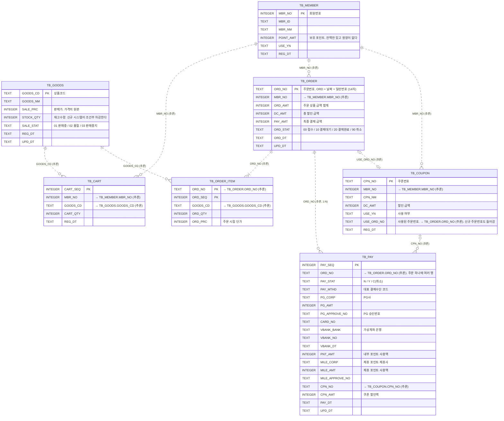
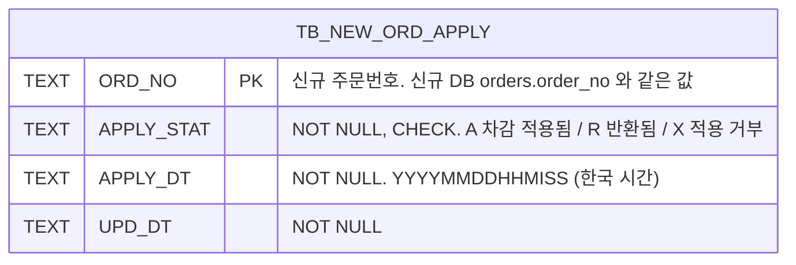

# 레거시 DB ERD

- 대상: `data/legacy.db` (테스트는 `build/test-db/legacy.db`)
- 스키마: `src/main/resources/db/legacy/legacy_db.sql`(과제 원본 `assignment/legacy_db.sql`의 사본) + `legacy_new_ord_apply.sql`(신규 시스템이 추가한 테이블)
- 접근: MyBatis (`legacy/mapper`)

## 읽는 법

- **레거시 DB에는 외래 키 선언이 하나도 없다.** 아래의 관계선은 모두 컬럼 이름과 초기 데이터로 **추론한 논리적 관계**이며 DB가 강제하지 않는다. 추론임을 나타내기 위해 전부 점선으로 그렸다.
- 컬럼 설명의 `→ 테이블.컬럼 (추론)`은 그 컬럼이 가리키는 것으로 보이는 대상이다.
- `PK`만 실제 제약이다. PK 외에는 `NOT NULL`, `UNIQUE`, `CHECK`가 없다(`TB_NEW_ORD_APPLY` 제외).
- 일시 컬럼은 `'YYYYMMDDHHMISS'` 문자열이고 한국 시간으로 가정한다(DESIGN.md 4.6).

## 기존 테이블 (과제 원본)

### `TB_COUPON.USE_ORD_NO`에는 신규 주문번호도 들어감

신규 시스템의 주문이 쿠폰을 쓰면 이 컬럼에 신규 주문번호(`N`으로 시작, 20자)가 기록된다. 신규 주문은 `TB_ORDER`에 없으므로, 이 값으로 `TB_ORDER`를 조인하면 행이 나오지 않는다. 위 그림의 `TB_ORDER`–`TB_COUPON` 관계선은 레거시 주문에 대해서만 성립한다. DESIGN.md 11장의 미결 사항 1이다.

| `USE_ORD_NO`의 값 | 가리키는 곳 |
|---|---|
| `ORD…` (14자) | 레거시 DB `TB_ORDER.ORD_NO` |
| `N…` (20자) | 신규 DB `orders.order_no` |
| NULL | 미사용 쿠폰 |

## 신규 시스템이 추가한 테이블

- 신규 주문의 재고·쿠폰·포인트 차감이 레거시에 반영됐는지를 남기는 반영 기록이다. 차감·반환과 같은 레거시 트랜잭션에서 기록한다(DESIGN.md 5장).
- **레거시의 다른 테이블과 관계가 없다.** `ORD_NO`는 레거시 `TB_ORDER`가 아니라 신규 DB의 `orders.order_no`를 가리킨다. DB가 달라 외래 키를 걸 수 없으므로 관계선을 그리지 않았다.
- 기존 테이블은 변경하지 않았다.

## 신규 시스템이 쓰는 레거시 컬럼

| 테이블.컬럼 | 신규 시스템의 사용 |
|---|---|
| `TB_GOODS.SALE_PRC`, `SALE_STAT`, `GOODS_NM` | 읽기 (주문 시점 가격 확정, 판매 여부 확인) |
| `TB_GOODS.STOCK_QTY` | 조건부 차감·반환 |
| `TB_MEMBER.MBR_NO`, `USE_YN` | 읽기 (주문 시 회원이 있고 `USE_YN = 'Y'`인지 확인) |
| `TB_MEMBER.POINT_AMT` | 조건부 차감·반환 |
| `TB_COUPON.USE_YN`, `USE_ORD_NO` | 조건부 사용 처리·반환 |
| `TB_COUPON.MBR_NO`, `DC_AMT` | 읽기 (소유자 확인, 할인 금액) |
| `TB_NEW_ORD_APPLY` 전체 | 읽기·쓰기 |
| `TB_CART` | 사용하지 않음. 설계상으로는 회원이 신규 장바구니에 처음 접근할 때 한 번 읽는다(DESIGN.md 8.4, 미구현) |
| `TB_ORDER`, `TB_ORDER_ITEM`, `TB_PAY` | 사용하지 않음 |
