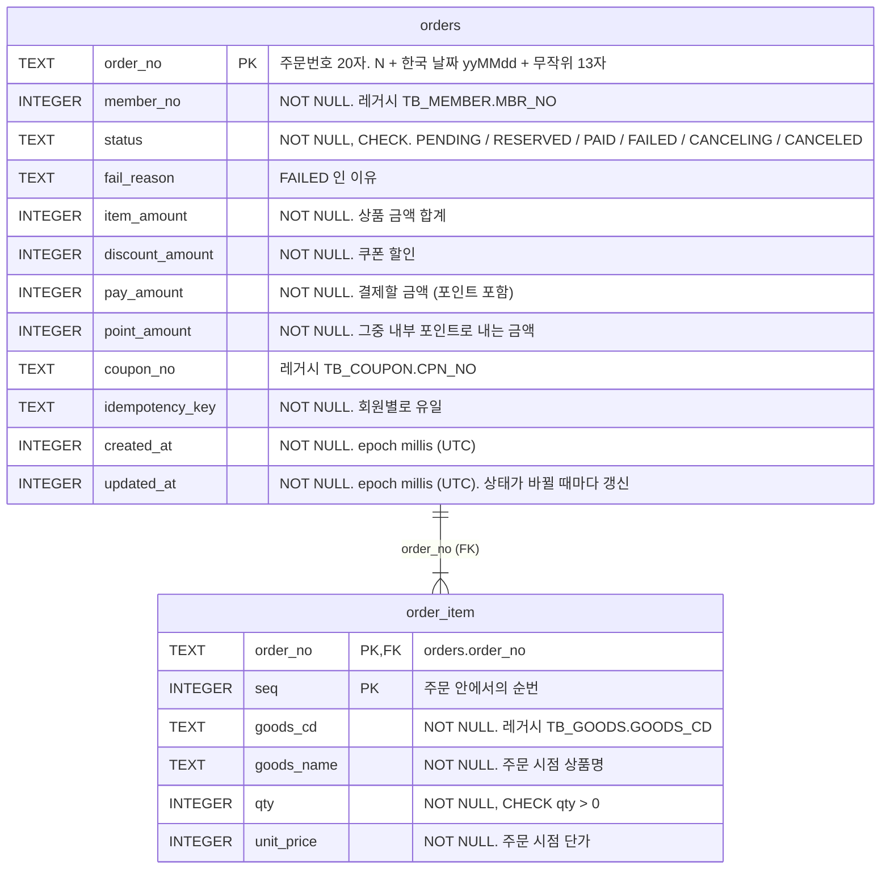
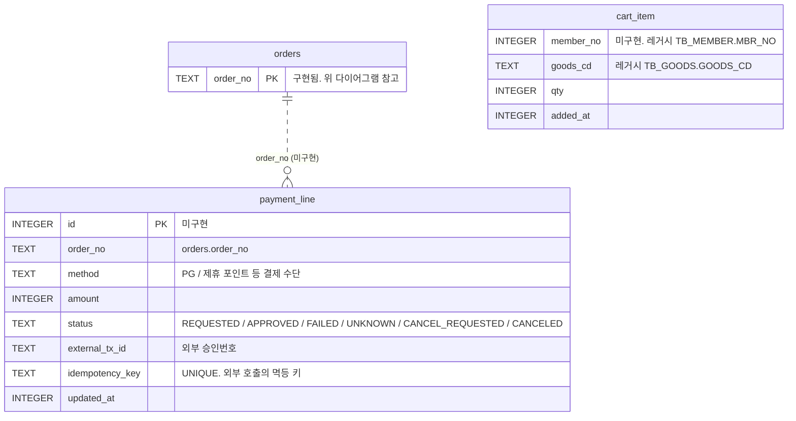

# 신규 DB ERD

- 대상: `data/new.db` (테스트는 `build/test-db/new.db`)
- 스키마: `src/main/resources/db/new/new_db.sql`
- 접근: Spring Data JPA (`domain/entity`, `domain/repository`)

## 읽는 법

- **구현된 테이블**과 **설계만 있는 테이블(미구현)**을 다이어그램을 나눠 그렸다. 미구현 테이블은 DESIGN.md 4.3과 7장의 설계이며 `new_db.sql`에 없다.
- 신규 DB는 외래 키 검사를 켠다(`foreign_keys`). 실선은 DDL에 선언된 외래 키다.
- 시각 컬럼은 UTC epoch millis다(DESIGN.md 4.6).
- 연결 확인용 테이블 `app_meta`는 도메인 테이블이 아니라서 제외했다.

## 구현된 테이블

제약과 인덱스:

| 대상 | 내용 |
|---|---|
| `orders` | `UNIQUE (member_no, idempotency_key)` |
| `orders` | `CHECK (item_amount - discount_amount = pay_amount)` |
| `orders` | `CHECK (point_amount <= pay_amount)`, 금액 컬럼은 모두 `>= 0` |
| `orders` | `INDEX (status, updated_at)`: 복구 작업자가 중간 상태에 머문 주문을 찾는다 |
| `order_item` | `PRIMARY KEY (order_no, seq)`, `FOREIGN KEY (order_no) → orders` |

주문의 금액과 품목은 생성 후 바뀌지 않는다. 바뀌는 것은 `status`, `fail_reason`, `updated_at`뿐이다.

## 설계만 있는 테이블 (미구현)

아래 두 테이블은 **구현하지 않았다.** `orders`는 관계를 보이기 위해 이름만 다시 그렸다.

- `payment_line`: 결제 수단마다 한 행을 두고 행마다 상태를 둔다(DESIGN.md 7장). 레거시 `TB_PAY`가 수단별 상태를 담지 못하는 문제를 푸는 구조다.
- `cart_item`: `UNIQUE (member_no, goods_cd)`. 가격은 저장하지 않는다(DESIGN.md 6.2). 다른 신규 테이블과 관계가 없다.

## 레거시 DB를 가리키는 컬럼

DB가 달라 외래 키를 걸 수 없다. 값이 유효한지는 주문 시점에 애플리케이션이 확인한다.

| 신규 DB 컬럼 | 가리키는 레거시 컬럼 | 확인하는 곳 |
|---|---|---|
| `orders.member_no` | `TB_MEMBER.MBR_NO` | 포인트 차감 조건, 쿠폰 소유자 조건 |
| `orders.coupon_no` | `TB_COUPON.CPN_NO` | 금액 계산, 쿠폰 사용 조건 |
| `order_item.goods_cd` | `TB_GOODS.GOODS_CD` | 금액 계산, 재고 차감 조건 |

반대 방향으로, 레거시 DB의 두 컬럼에 신규 주문번호가 기록된다([legacy.md](legacy.md)).

| 레거시 컬럼 | 들어가는 값 |
|---|---|
| `TB_NEW_ORD_APPLY.ORD_NO` | `orders.order_no` |
| `TB_COUPON.USE_ORD_NO` | 쿠폰을 쓴 주문의 `orders.order_no` |
